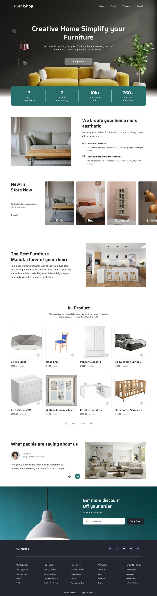
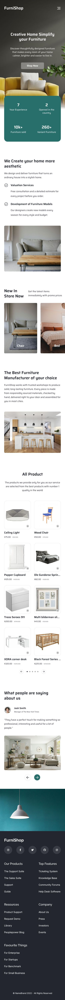

# Лабораторна робота 1. Адаптивна верстка лендінгу FurniShop

| | |
|---|---|
| Прізвище | _____________ |
| Група | _____________ |
| Номер варіанта | _____________ |
| Макет (Figma, Lab 1) | https://www.figma.com/design/k4xYzlZSeAcyZPnXM0c27m/Lab-1 |
| **GitHub Pages** | **https://<логін>.github.io/<репозиторій>/** ← вставити після публікації |

## Скріншоти

| Десктоп (1440 px) | Мобільний (390 px) |
|---|---|
|  |  |

## Макет: що зчитано з інспектора Figma

- Фрейми: **Furniture Web = 1440 px**, **Furniture Mobile = 390 px** (це «ширина десктопного фрейму» для перевірки: 360 / 1440 / 1920).
- Контентна область: 1240 px (поле 100 px), шапка 1160 px (поле 130), підвал 1140 px (поле 150). Мобільне поле 25 px.
- Колір акценту `#286F6C`, текст `#23262F`, підкладка зображень `#EAEEF3`, скло кнопки `#E2E2E2` при 40 %.
- Радіуси: 5 / 6 / 8 / 10 / 16 / 20 px. Шрифти: Saira (400–700), Raleway (Medium, Bold) і Inter (Regular) у підвалі, іконки Font Awesome 5 Brands.
- Висоти секцій на десктопі збігаються з макетом: Hero 1000, Features 591, New In Store 540, Manufacturer 591, Testimonial 480, CTA 490, Footer 513 px; усього 5459 проти 5457 у макеті.

## Фреймворк

Не використовується: власний CSS (Flexbox + Grid), невеликий reset на початку `style.css`. Тому пояснення «що стоїть за класами» зводиться до властивостей, які видно в коді.

## Шрифти

Усі три шрифти з макета є в Google Fonts, заміна не потрібна. Підключені в `<head>` (`index.html`, рядки 10–15). Іконки соцмереж: Font Awesome 5 з cdnjs.

## Застосовані техніки (рядки в `css/style.css`, якщо не вказано інше)

| Вимога | Де |
|---|---|
| Семантика HTML5 (`header`, `nav`, `main`, `section`, `article`, `figure`, `blockquote`, `footer`), один `h1`, ієрархія h1 → h2 → h3, `alt` на всіх зображеннях (декоративне фото CTA з `alt=""`) | `index.html` |
| **Flexbox №1** шапка: логотип / меню / дії | 169–174 |
| **Flexbox №2** головний екран: колонка з вирівнюванням по центру | 267–273 |
| **Flexbox №3** переваги: текст і фото в рядок, `align-items: center`, `row-reverse` | 339–343, 789 |
| **Flexbox №4** картка товару: зображення → назва → ціна → кнопка | 460–464 |
| **Flexbox №5** нижній рядок підвалу | 710–716 |
| **CSS Grid №1** сітка карток: `repeat(var(--products-cols), minmax(0, 1fr))` | 453–457 |
| **CSS Grid №2** колонки підвалу (2 → 3 → `repeat(4, 1fr) auto`) | 687–693, 911 |
| Додатково Grid: `grid-template-areas` у відгуках, статистика, накладання шарів | 542–550, 313–317, 225 |
| Адаптивність | `@media (min-width: 48rem)` (768 px) рядок 726, `@media (min-width: 75rem)` (1200 px) рядок 908 |
| `clamp()` для рівнів тексту | змінні `--fs-display`, `--fs-heading`, `--fs-lead`, `--fs-body` та інші, рядки 32–40; формула: `clamp(мін, a + b·vw, макс)`, лінійна між 390 і 1440 px |
| Змінні теми в `:root` | рядки 10–60 (`--color-accent`, `--radius-*`, `--gutter`, `--fs-*`) |
| Розміри в `rem` | усі шрифти, відступи, радіуси; `px` тільки для рамок 1 px |
| Контейнер | `.container`: `max-width: 90rem; margin-inline: auto; padding-inline: var(--gutter)` |
| Зображення | `max-width: 100%; height: auto` у reset, `object-fit` у рамках, `loading="lazy"` нижче першого екрана |

### Як працюють основні властивості (для захисту)

- `display: flex` розкладає дітей в один вимір; `justify-content` розподіляє вздовж головної осі, `align-items` вирівнює впоперек, `gap` задає проміжки.
- `display: grid` розкладає в два виміри; `repeat(4, minmax(0, 1fr))` це 4 рівні колонки, де `minmax(0, …)` дозволяє колонці стискатися менше за вміст і не ламати сітку.
- `clamp(1.5rem, 0.571rem + 3.81vw, 4rem)`: значення плавно росте з шириною вікна, але не менше 24 px і не більше 64 px.
- Мобільне меню без JS: прихований `<input type="checkbox">`, селектор `:checked ~ .main-nav` показує панель.

## Відхилення від тексту завдання (навмисні)

У самому макеті сітка товарів така: **8 карток, 4 колонки на десктопі і 2 колонки на мобільному**. Текст завдання каже «3 колонки / 1 колонка», тому додатково зроблено 3 колонки на планшеті (768–1199 px). Кількість колонок керується однією змінною `--products-cols` (рядки 59 і 904+), тож перейти на «3 / 1» можна зміною двох значень.

Також виправлені очевидні помилки в тексті макета («Simpify», «aestetic», «Furnitre»), а безглуздий опис у hero замінений змістовним.

## Перевірка

- Ширини 360, 390, 768, 1280, 1440, 1920 px: горизонтальної прокрутки немає (`scrollWidth == clientWidth` на кожній).
- На 1920 px контент центрований у 1440 px, фонові зображення hero й CTA розтягуються на всю ширину.
- W3C Nu Validator: 0 помилок і 0 попереджень для `index.html` і `css/style.css`.
- Немає `style=""`, `float`, таблиць. `position: absolute` використано лише для накладання (шапка на hero, фон-зображення, хотспоти), не для основної сітки.

## Структура

```
lab1/
├── index.html
├── css/style.css
├── img/        (зображення з макета, стиснуті, + скріншоти)
└── README.md
```

## Публікація на GitHub Pages

```bash
cd lab1
git init && git add . && git commit -m "Lab 1: FurniShop landing"
git branch -M main
git remote add origin https://github.com/<логін>/<репозиторій>.git
git push -u origin main
```
Потім на GitHub: **Settings → Pages → Source: Deploy from a branch → main / (root) → Save**. Через хвилину сторінка буде за адресою `https://<логін>.github.io/<репозиторій>/`. Вставте її у таблицю вгорі.
